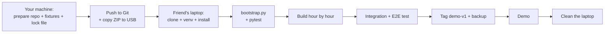

# Nyaya Saarathi — End-to-End Build, Move, Run and Demo Guide

**From an empty folder to a rehearsed demo, on any laptop — including your friend's — without breaking anything.**

> Companion to **Nyaya Saarathi Technical Architecture** (the *what* and *where* of every file). This guide is the *when* and *how*: exact steps, in order, with "done when" checks.

---

## Table of Contents

1. [The Plan in One Page](#1-the-plan-in-one-page)
2. [Before You Leave Your Machine](#2-before-you-leave-your-machine)
3. [Setting Up the Friend's Laptop](#3-setting-up-the-friends-laptop)
4. [Bootstrap Scripts](#4-bootstrap-scripts)
5. [The Build, Hour by Hour](#5-the-build-hour-by-hour)
6. [Working Together on One Repo](#6-working-together-on-one-repo)
7. [Integration and End-to-End Test](#7-integration-and-end-to-end-test)
8. [Demo Day Runbook](#8-demo-day-runbook)
9. [Backup Plans](#9-backup-plans)
10. [Leaving the Laptop Clean](#10-leaving-the-laptop-clean)
11. [Troubleshooting](#11-troubleshooting)
12. [Master Checklists](#12-master-checklists)

---

## 1. The Plan in One Page



**The three ideas that keep your work safe:**

1. **Git is the single source of truth.** If it isn't committed, it doesn't exist.
2. **Mock mode makes the demo independent of internet and API.** The app runs fully offline.
3. **Everything is rebuilt by scripts.** `bootstrap.py` recreates folders, database, synthetic documents, and checks the setup.

---

## 2. Before You Leave Your Machine

Do this **once**, before touching the friend's laptop.

### 2.1 Prepare the repository skeleton
Create the folder structure from the Technical Architecture (§3) and commit it:

```bash
mkdir nyaya-saarathi && cd nyaya-saarathi
git init
echo "3.11" > .python-version
# create folders and empty files per the architecture, then:
git add . && git commit -m "Project skeleton"
```

### 2.2 Create a private remote
- Create a **private** GitHub/GitLab repo.
- Add every teammate as a collaborator.
- `git remote add origin <url>` → `git push -u origin main`

### 2.3 Prepare these files *before* the build day
| File | Why prepare early |
|---|---|
| `requirements.txt` | Library list |
| `.env.example` | Config template |
| `.gitignore` | Prevents secrets/data from being committed |
| `packs/unpaid_wages_v1.json` | Real requirements need research time (see §5, Hour 0–1) |
| `fixtures/extractions/*.json` | Mock LLM outputs |
| `scripts/bootstrap.py`, `scripts/make_synthetic_docs.py` | Code in §4 |
| `README.md` | Three-line setup instructions (see §2.6) |

### 2.4 Freeze the working environment
Once the skeleton runs on **your** machine (`streamlit run app.py` opens a page and `pytest -q` passes):

```bash
pip freeze > requirements.lock.txt
git add requirements.lock.txt && git commit -m "Lock dependencies" && git push
```

### 2.5 Make an offline travel kit (recommended)
Copy these to a USB drive or cloud folder, **in addition to Git**:

| Item | How |
|---|---|
| Repo ZIP | `git archive -o nyaya-saarathi.zip HEAD` |
| Python 3.11 installer | Download for the **friend's OS** |
| Wheelhouse (offline libraries) | `pip download -r requirements.lock.txt -d wheelhouse` — must be made on a machine with the **same OS and Python version** as the target; otherwise skip and rely on internet |
| Demo video backup | Screen recording of the working flow (see §9) |
| `.env` values | Written down **separately and privately**; never in the ZIP |

### 2.6 `README.md` (keep it this short)

```markdown
# Nyaya Saarathi
Requires Python 3.11.
1. python -m venv .venv  &&  activate it
2. pip install -r requirements.lock.txt
3. copy .env.example to .env  (LLM_PROVIDER=mock works offline)
4. python scripts/bootstrap.py
5. streamlit run app.py        # tests: pytest -q
```

### 2.7 Decide the API-key plan
| Option | Use when |
|---|---|
| **Mock only** (`LLM_PROVIDER=mock`) | Safest. Demo works everywhere. |
| **Gemini with a temporary key** | You want to show live extraction. Create a *separate* key just for this event; **revoke it afterward**. |
| **Gemini + cache** | Run the demo case once live (results cached in SQLite), then rely on the cache/mock if Wi-Fi fails. |

**Never** commit the key, paste it into code, or send it in a group chat. Put it in `.env` on the friend's laptop only for the event.

---

## 3. Setting Up the Friend's Laptop

Estimated time: **20–30 minutes**. Do it *before* the build clock starts.

### 3.1 Install the basics

| Tool | Check | If missing |
|---|---|---|
| Python **3.11** | `python --version` | Install 3.11 (tick "Add to PATH" on Windows) |
| Git | `git --version` | Install Git |
| Editor | VS Code | Install; add the Python extension |
| Browser | Chrome/Edge | — |

> **Do not upgrade or change anything else on the friend's laptop.** A virtual environment keeps your libraries completely separate from their system.

### 3.2 Get the project

```bash
cd ~/Desktop            # or any folder
git clone <your-private-repo-url> nyaya-saarathi
cd nyaya-saarathi
```
*(No internet? Unzip `nyaya-saarathi.zip` instead.)*

### 3.3 Create the isolated environment

**Windows (PowerShell)**
```powershell
python -m venv .venv
.venv\Scripts\Activate.ps1
```
**Mac / Linux**
```bash
python3.11 -m venv .venv
source .venv/bin/activate
```

> If PowerShell blocks activation: `Set-ExecutionPolicy -Scope Process Bypass` (affects only that window).

### 3.4 Install the exact libraries

```bash
pip install -r requirements.lock.txt
# offline alternative (wheelhouse folder from USB):
pip install --no-index --find-links wheelhouse -r requirements.lock.txt
```

### 3.5 Configure

```bash
cp .env.example .env          # Windows: copy .env.example .env
```
Edit `.env`:
```ini
LLM_PROVIDER=mock
APP_ENV=demo
```
*(Add `GEMINI_API_KEY` and `LLM_PROVIDER=gemini` only if using live mode.)*

### 3.6 Verify the setup

```bash
python scripts/bootstrap.py
pytest -q
streamlit run app.py
```

**Done when:**
- [ ] `bootstrap.py` prints `ALL CHECKS PASSED`
- [ ] `pytest -q` is green
- [ ] Browser opens `http://localhost:8501` showing the Welcome screen

If any check fails, see [Troubleshooting](#11-troubleshooting) **before** writing code.

---

## 4. Bootstrap Scripts

### 4.1 `scripts/make_synthetic_docs.py`

Creates the demo documents. All people, companies, and numbers are **fictional**.

```python
from pathlib import Path
import fitz  # PyMuPDF

OUT = Path(__file__).resolve().parent.parent / "fixtures" / "docs"
OUT.mkdir(parents=True, exist_ok=True)

LETTER = """SUNRISE TEXTILES PVT LTD
12 Sample Industrial Estate, Sampletown

Date: 20 January 2026

To: Ms. Priya Raman

Subject: Appointment as Tailoring Assistant

Dear Ms. Priya Raman,

We are pleased to offer you the position of Tailoring Assistant. Your date of joining will be 1 February 2026. You will receive a monthly salary of Rs. 15,000, payable on or before the 5th of every month.

Yours sincerely,
HR Department, Sunrise Textiles Pvt Ltd
"""

BANK = """SAMPLE BANK - ACCOUNT STATEMENT (SYNTHETIC)
Account holder: Priya Raman

Date        Narration                         Credit     Debit
05/03/2026  SALARY SUNRISE TEXTILES FEB       15000
10/03/2026  UPI PAYMENT GROCERY                          1200
15/03/2026  CASH WITHDRAWAL                              3000
"""

MESSAGE = """Hi Priya, salary for March will be paid by 10 April 2026. Please wait a little longer. - Manager, Sunrise Textiles"""

def pdf(name: str, text: str) -> None:
    doc = fitz.open()
    page = doc.new_page()
    page.insert_textbox(fitz.Rect(72, 72, 523, 770), text, fontsize=11)
    doc.save(OUT / name)
    doc.close()

if __name__ == "__main__":
    pdf("employment_letter.pdf", LETTER)
    pdf("bank_statement.pdf", BANK)
    (OUT / "employer_message.txt").write_text(MESSAGE, encoding="utf-8")
    print("Synthetic documents written to", OUT)
```

> Bank statement and letter dates are intentionally consistent with the story except the **planted conflict**: the user says they started in **January**, the letter says **1 February 2026**. The statement shows a salary credit for February only, so the unpaid months are **not stated anywhere** — the planted **gap**.

### 4.2 Mock extraction fixtures (must match the text above exactly)

`fixtures/extractions/employment_letter.json`
```json
{"facts": [
 {"field_name":"employer_name","value":"Sunrise Textiles Pvt Ltd","page_number":1,"excerpt":"SUNRISE TEXTILES PVT LTD","confidence":"high"},
 {"field_name":"employee_name","value":"Priya Raman","page_number":1,"excerpt":"Ms. Priya Raman","confidence":"high"},
 {"field_name":"start_date","value":"1 February 2026","page_number":1,"excerpt":"Your date of joining will be 1 February 2026","confidence":"high"},
 {"field_name":"monthly_salary","value":"Rs. 15,000","page_number":1,"excerpt":"a monthly salary of Rs. 15,000","confidence":"high"}
]}
```

`fixtures/extractions/employer_message.json`
```json
{"facts": [
 {"field_name":"payment_date","value":"10 April 2026","page_number":1,"excerpt":"salary for March will be paid by 10 April 2026","confidence":"high"},
 {"field_name":"payment_promise","value":"Salary for March will be paid by 10 April 2026","page_number":1,"excerpt":"Please wait a little longer","confidence":"medium"}
]}
```

`fixtures/extractions/bank_statement.json`
```json
{"facts": [
 {"field_name":"employer_name","value":"Sunrise Textiles","page_number":1,"excerpt":"SALARY SUNRISE TEXTILES FEB","confidence":"medium"}
]}
```

`fixtures/extractions/user_story.json`
```json
{"facts": [
 {"field_name":"start_date","value":"January 2026","page_number":1,"excerpt":"I started working in January","confidence":"medium"}
]}
```

**Demo story to type on the Intake screen (exact text):**
> My employer has not paid my salary for three months. I started working in January.

> ⚠️ The excerpt in each fixture must appear **verbatim** in its document (case and spacing are ignored). If you change a document's wording, update its fixture, or the facts will show "Source not verified."

### 4.3 `scripts/bootstrap.py`

```python
"""Idempotent setup + self-check. Safe to run any number of times."""
import sys, json
from pathlib import Path
sys.path.insert(0, str(Path(__file__).resolve().parent.parent))

def main():
    import config
    from core import db
    from core.packs import list_pathways

    print("• Python:", sys.version.split()[0])
    assert sys.version_info[:2] == (3, 11), "Use Python 3.11 for identical behaviour"

    print("• Data folders:", config.DATA_DIR)
    db.init_db()
    print("• Database initialised:", config.DB_PATH)

    import subprocess
    subprocess.run([sys.executable, str(Path(__file__).with_name("make_synthetic_docs.py"))], check=True)

    packs = list_pathways()
    assert packs, "No pathway packs found in /packs"
    for p in packs:
        print(f"• Pack OK: {p.pathway_id} v{p.pack_version} ({p.review_status})")

    for f in ["employment_letter", "employer_message", "bank_statement", "user_story"]:
        data = json.loads((config.FIXTURES / "extractions" / f"{f}.json").read_text(encoding="utf-8"))
        assert "facts" in data, f"Bad fixture {f}"
    print("• Mock fixtures OK")
    print("• LLM provider:", config.LLM_PROVIDER)
    print("\nALL CHECKS PASSED")

if __name__ == "__main__":
    main()
```

### 4.4 Optional `scripts/verify_links.py`
Loops over `handoff_links` in each pack, requests each URL, prints status. Run it **with internet, the morning of the demo**, and update `last_checked` dates in the pack.

---

## 5. The Build, Hour by Hour

Each block lists **who**, **files**, **what to do**, and **Done when**. Keep the Technical Architecture open for the code.

### Roles (3 people)

| Person | Hat | Primary folders |
|---|---|---|
| **A — Experience & Demo** | UI | `app.py`, `ui/`, `i18n/` |
| **B — Data & Documents** | Storage and files | `core/db.py`, `schema.sql`, `doc_reader.py`, `exporter.py`, `privacy.py`, `pipeline.py` |
| **C — Intelligence & Checking** | Rules and AI | `packs/`, `fields.py`, `normalize.py`, `llm.py`, `extractor.py`, `checker.py`, `requirements_engine.py`, `gaps.py`, `questions.py`, `prompts.py`, `fixtures/`, `tests/` |

### Hour 0–1 — Lock the contracts (everyone, together)

| Task | Owner | Output |
|---|---|---|
| Agree the **field registry** (`fields.py`) and **status names** | All | Same vocabulary |
| Agree **function signatures** from the Technical Architecture §9–10 | All | No surprises at integration |
| Research official sources and write the **real pack** | C (with one other) | `packs/unpaid_wages_v1.json` with real sources and dates |
| Create synthetic documents | C | `make_synthetic_docs.py` output |
| Run setup checks on the laptop | B | `bootstrap.py` passes |
| Create branches | All | `feat/ui`, `feat/data`, `feat/logic` |

**Done when:** `bootstrap.py` passes, pack validates (`load_pack` asserts nothing), everyone can run the empty app.

### Hour 1–2 — Foundations

| Person | Task | Done when |
|---|---|---|
| **B** | `schema.sql`, `db.py`, `privacy.py`; test insert/read/delete session | `delete_session` removes rows (write test) |
| **C** | `normalize.py` + `test_normalize.py`; `checker.py` + `test_checker.py` | Both test files green |
| **A** | `app.py` router, `ui/state.py`, `welcome`, `intake`, `pathway` pages | Can click Welcome → Intake → Pathway |

**Commit and push** at the end of the hour. Everyone pulls.

### Hour 2–4 — Documents to facts

| Person | Task | Done when |
|---|---|---|
| **B** | `doc_reader.py` (validation + PyMuPDF), upload storage in `pipeline.process_document` | Uploading the letter PDF creates a `documents` row and file |
| **C** | `llm.py` (mock + cache + gemini), `extractor.py` with excerpt verification, `prompts.py` | Letter fixture → 4 facts, all `verified=1` |
| **A** | `requirements` page and `upload` page (progress and error messages) | Upload shows status and friendly errors |

**Done when:** uploading `employment_letter.pdf` shows 4 facts stored with page 1 and verified sources (check via a temporary debug table in the UI).

### Hour 4–6 — Rules and the Dashboard

| Person | Task | Done when |
|---|---|---|
| **C** | `packs.py`, `requirements_engine.py`, `gaps.py` (detect/sync), `checklist.py`; tests for status ordering | Test matrix green |
| **B** | `pipeline.recheck()` wiring; `create_case`; story extraction | Story + letter → exactly **one** conflict gap on `start_date` |
| **A** | `dashboard` page with status chips, counts, source links, no score | Dashboard shows REQ-02 "Please clarify" and REQ-04 "Not yet provided" |

### Hour 6–8 — The "wow" moment

| Person | Task | Done when |
|---|---|---|
| **C** | `questions.py`; `gaps.apply_answer`; `test_gaps_loop.py` | Test proves originals unchanged after answer |
| **B** | `graph.py` (`rebuild`, `to_dot`) | DOT string renders in `st.graphviz_chart` |
| **A** | `evidence_map` page (graph + card view + detail panel) and `clarify` page with **"What changed"** box | Answering the date question updates map and dashboard live |

**Done when:** you can run the full demo story and see: conflict → question → answer → map updates → REQ-02 becomes "Information found" while the letter's date is still visible.

### Hour 8–9 — Outputs

| Person | Task | Done when |
|---|---|---|
| **C** | `summary.py` wording review (no legal conclusions) | Phrase-lint test passes |
| **B** | `exporter.py`, README text, ZIP contents test | ZIP has summary, indices, checklist, links, selected docs only |
| **A** | `review_export` page (editable summary, document picker, approval checkbox, download) and `human_help` page | Download disabled until approval is ticked |

### Hour 9–10 — Harden and rehearse (everyone)

1. Run the **full E2E checklist** (§7).
2. Fix only **blocking** bugs.
3. Verify links with `verify_links.py` (needs internet).
4. Record the **backup video** (§9).
5. Run the demo **twice** end to end, timing it.
6. Tag the release (below).

### 5.1 If you fall behind — drop in this order

| Drop first | Replacement |
|---|---|
| Tamil UI polish | English + Tamil for requirements and welcome only |
| Graph visual | Card view only |
| PDF export | ZIP only |
| Live Gemini | Mock mode |
| Admin/support views | Slide in the pitch |
| Second pathway | Roadmap slide |

**Never drop:** story → documents → facts with sources → planted conflict → clarification → live update → dashboard → approved ZIP.

---

## 6. Working Together on One Repo

### 6.1 Branches and merging
```text
main            ← always runs; only merge tested work
 ├─ feat/ui     (A)
 ├─ feat/data   (B)
 └─ feat/logic  (C)
```

**Hourly rhythm:**
```bash
git pull origin main                  # start of hour
# ...work...
pytest -q                             # before merging
git add -A && git commit -m "clear message"
git push origin feat/<yours>
# open merge request, or:  git checkout main && git pull && git merge feat/<yours> && git push
```

### 6.2 Rules that prevent collisions
1. **Own your folders** (see roles). Need a change in someone else's file? Ask them or make a tiny, announced commit.
2. **Never edit `schema.sql` casually.** If a column is needed, tell B; when the schema changes, everyone deletes `data/app.db` and reruns `bootstrap.py`.
3. **UI never touches SQL.** It calls `core/` functions only.
4. **Nobody commits `.env` or `data/`.**
5. **Merge main into your branch before demo-critical work.**
6. **One person is the "release captain"** who merges to `main` in the last two hours.

### 6.3 Using two or more laptops
- Each person can work on their own laptop and push to Git; the friend's laptop is the **integration machine**: `git pull` there, run, test.
- Only the integration laptop needs the demo `.env`.
- If two people edit on the *same* laptop, use separate branches and commit before switching.

### 6.4 Freeze the demo

```bash
git checkout main && git pull
pytest -q                              # must be green
git tag demo-v1
git push origin demo-v1
```
From now on, **do not edit main**. Fixes go to a `hotfix` branch and are merged only if the demo is broken.

**Recovery command** if anything goes wrong on demo day:
```bash
git checkout demo-v1
```

---

## 7. Integration and End-to-End Test

### 7.1 Automated
```bash
pytest -q
```
Must include the demo-case test comparing results to `fixtures/expected/demo_case_expected.json`.

### 7.2 Manual end-to-end script (do it in order)

| # | Action | Expected result |
|---|---|---|
| 1 | Open app, select English | Welcome with disclaimer, consent checkbox |
| 2 | Tick consent, Start | Intake screen |
| 3 | Paste the demo story | Accepted |
| 4 | Pathway screen | Wages pathway card with **authority, source, version/date** |
| 5 | Confirm pathway | Requirements list in plain language with source links |
| 6 | Upload `employment_letter.pdf` | 4 facts found, page 1, sources verified |
| 7 | Upload `employer_message.txt` | Payment facts found |
| 8 | Upload `bank_statement.pdf` | Facts found |
| 9 | Evidence Map | Graph shows documents → facts; amber **start-date conflict** |
| 10 | Click the letter's start-date fact | Detail panel shows value, page 1, excerpt, "Document" origin |
| 11 | Clarify screen | Neutral question showing **both** values and **both** sources |
| 12 | Answer with the date you choose | "What changed" box: added answer, originals unchanged |
| 13 | Evidence Map again | Conflict resolved; `ANSWERED_BY` edge visible; original facts still there |
| 14 | Clarify: missing months | Answer "March, April, May" → REQ-04 becomes found |
| 15 | Dashboard | Statuses updated; **no score**, no eligibility language |
| 16 | Review & Export | Editable summary; evidence index; choose documents |
| 17 | Try download before approval | **Blocked** |
| 18 | Tick approval, download | ZIP with summary, indices, checklist, links, README, **only selected** docs |
| 19 | Human help screen | Verified links shown |
| 20 | Delete my session | Data gone; app returns to Welcome |

### 7.3 Negative tests
- Upload a `.docx` → friendly "not supported" message.
- Upload a scanned/empty PDF → "paste the text" message.
- Turn off Wi-Fi with `LLM_PROVIDER=gemini` → "Offline mode" notice; flow still works.
- Mark a requirement "I don't know" → status "You marked: not available".
- Open the app in two browsers → sessions don't see each other's data.
- Search the UI for the words *eligible, guarantee, chance, strong case* → only in disclaimers.

---

## 8. Demo Day Runbook

### 8.1 Two hours before
- [ ] Laptop charged + charger packed; auto-sleep disabled.
- [ ] Notifications off; browser at 100% zoom; extra tabs closed.
- [ ] `git status` clean; on tag `demo-v1`.
- [ ] `python scripts/bootstrap.py` → ALL CHECKS PASSED.
- [ ] `pytest -q` green.
- [ ] Decide mode: `mock` (safe) or `gemini` (live).
- [ ] Run links check; update `last_checked` if needed.
- [ ] Clear previous sessions: delete `data/app.db` → rerun bootstrap (fresh start).
- [ ] Open the app once, run the full flow, then **Delete my session**.

### 8.2 Ten minutes before
- [ ] `streamlit run app.py` running in one terminal (leave it).
- [ ] Browser on Welcome screen, full-screen.
- [ ] Synthetic files visible in a folder for easy drag-and-drop (or pre-opened file dialog).
- [ ] Backup video and slides ready on the same laptop.
- [ ] The demo story text copied to clipboard.

### 8.3 Role split during the demo
| Person | Does |
|---|---|
| Presenter | Speaks, drives the screen |
| Co-presenter | Watches timing, answers technical questions |
| Third | Backup laptop/video, handles Q&A on privacy and limits |

### 8.4 Five-minute flow
1. **Hook (20 s):** "People have papers but can't see the full picture."
2. **Trust (20 s):** disclaimer, consent, "not a lawyer."
3. **Story + pathway (30 s):** type story; show official source and version/date.
4. **Upload (30 s):** three synthetic documents → facts with sources.
5. **Map + conflict (60 s):** click a fact → source page and excerpt; show **two different start dates**.
6. **Clarify (60 s):** neutral question → answer → "What changed": originals preserved, map and dashboard update.
7. **Dashboard (30 s):** statuses, no scores.
8. **Export (30 s):** approve → ZIP.
9. **Close (20 s):** one-line pitch + limits.

### 8.5 Words to use and avoid
| Say | Avoid |
|---|---|
| "preparation", "organize", "source-linked" | "eligibility check", "legal advice", "AI lawyer" |
| "the system flags for review" | "the system found the error" |
| "unvalidated hypothesis" | "proven impact" |
| "official sources, versioned" | "complete legal coverage" |

### 8.6 If a judge asks to try their own document
Say: "The demo uses synthetic data only for privacy. A new document type would need a new field mapping, but you can paste text from a sample." Do not upload real personal documents.

---

## 9. Backup Plans

| Risk | Backup |
|---|---|
| Wi-Fi fails | `LLM_PROVIDER=mock` — fully offline |
| API quota or key problem | Mock mode / cache |
| App crashes | Restart: `Ctrl+C`, `streamlit run app.py`; Welcome screen in seconds |
| Wrong data state | Delete `data/app.db`, rerun `bootstrap.py` |
| Graph does not render | Switch to **Card view** tab |
| Laptop dies | Second teammate's laptop: clone repo, `git checkout demo-v1`, `pip install -r requirements.lock.txt`, `bootstrap.py` |
| Everything fails | **Backup screen recording** (record at Hour 9 on the final build; keep a copy on phone and USB) |
| Projector resolution issues | Browser zoom 110–125%; sidebar collapsed |

**Always have:** (1) the demo video, (2) a PDF of 6–8 slides with screenshots of each stage, (3) the repo tag `demo-v1`.

---

## 10. Leaving the Laptop Clean

The laptop belongs to your friend and may contain your demo data and API key.

```bash
# 1. Remove runtime data and secrets
rm -rf data/ .env              # Windows: rmdir /s /q data  &  del .env

# 2. Optionally remove the whole project (after pushing everything)
git status                     # confirm nothing important is uncommitted
git push --all origin
cd .. && rm -rf nyaya-saarathi

# 3. Deactivate and optionally delete the environment (it lived inside the folder)
deactivate
```

**Also:**
- [ ] **Revoke the temporary Gemini API key** in the provider console.
- [ ] Remove saved browser logins and clear the browser cache for the git host.
- [ ] Remove Git credentials if stored (`git credential-manager` / Keychain / Credential Manager).
- [ ] Empty trash; remove USB copies of `.env`.
- [ ] Confirm no real personal documents were ever placed on the laptop (only synthetic).

---

## 11. Troubleshooting

| Symptom | Likely cause | Fix |
|---|---|---|
| `python --version` is not 3.11 | Another Python first on PATH | Use `python3.11` / `py -3.11`; recreate the venv |
| `ModuleNotFoundError: fitz` | Venv not active, or install skipped | Activate venv; `pip install -r requirements.lock.txt` |
| PyMuPDF install fails | Wrong Python/OS wheel | Use Python 3.11; update pip: `python -m pip install -U pip` |
| `streamlit: command not found` | Venv not active | Activate; or `python -m streamlit run app.py` |
| Port 8501 busy | Old instance running | `streamlit run app.py --server.port 8502` |
| `sqlite3.OperationalError: no such table` | DB not initialised or old schema | Delete `data/app.db`; run `bootstrap.py` |
| `database is locked` | Two processes writing | Close the extra app; add `timeout=10` in `sqlite3.connect` |
| Facts show "Source not verified" | Fixture excerpt doesn't match document text | Make the excerpt verbatim; regenerate docs |
| No facts extracted in mock mode | `hint` doesn't match fixture filename | Hint = file name without extension (`employment_letter`) |
| Conflict not detected | Date didn't normalize | Check `normalized_value`; use test cases in `test_normalize.py` |
| Conflict reappears after answer | Answer fact missing `is_clarification=1` | Verify `apply_answer` inserts it with `1` |
| Dashboard doesn't update | `recheck()` not called after change | Every write path must end in `pipeline.recheck()` |
| Graph blank | No edges yet, or DOT error | Open Card view; print `graph.to_dot()` to debug |
| Gemini errors | Key missing, wrong model name, quota | Check `.env`; model names change — verify in provider docs; fall back to mock |
| Tamil text shows boxes | Font not available | Use a browser with Tamil font support; check `lang="ta"` strings display on that laptop beforehand |
| Windows path issues | Hard-coded slashes | Use `pathlib` only (already in the design) |
| PowerShell blocks venv activation | Execution policy | `Set-ExecutionPolicy -Scope Process Bypass` |
| Git push rejected | Branch behind | `git pull --rebase origin <branch>` then push |
| Merge conflict in `schema.sql` | Two people edited | Keep both columns; delete `data/app.db`; rerun bootstrap |

---

## 12. Master Checklists

### 12.1 Pre-travel (your machine)
- [ ] Repo pushed to a **private** remote; teammates added
- [ ] `requirements.txt` and `requirements.lock.txt` committed
- [ ] `.env.example` committed; `.env` ignored
- [ ] `README.md` with 5-line setup
- [ ] Synthetic document script and mock fixtures committed
- [ ] USB: repo ZIP, Python 3.11 installer, optional wheelhouse, backup video (when available)
- [ ] API key stored privately (or mock-only decided)

### 12.2 Setup on friend's laptop
- [ ] Python 3.11 + Git installed
- [ ] Repo cloned
- [ ] Venv created and activated
- [ ] Libraries installed from the **lock** file
- [ ] `.env` created
- [ ] `bootstrap.py` → ALL CHECKS PASSED
- [ ] `pytest -q` green
- [ ] App opens at `localhost:8501`

### 12.3 Feature-complete
- [ ] Consent + language
- [ ] Intake + pathway card with source and version/date
- [ ] Requirements explained with source links
- [ ] Upload (PDF, text), friendly errors
- [ ] Facts with verified sources and origin labels
- [ ] Planted conflict detected; missing item detected
- [ ] Evidence Map (graph + card view) with detail panel
- [ ] Clarification loop with "What changed"
- [ ] Dashboard with statuses (no score)
- [ ] Editable summary; approval gate; ZIP export
- [ ] Human-help page with verified links
- [ ] Delete my session works

### 12.4 Safety and trust
- [ ] Demo banner: synthetic data only
- [ ] "Not a lawyer" visible
- [ ] AI-processing disclosure shown
- [ ] No eligibility/outcome language (phrase-lint test passes)
- [ ] Pack `review_status` visible; real sources and dates present
- [ ] Links verified within 24 hours
- [ ] No secrets in Git history (`git log -p | grep -i api_key` shows nothing)

### 12.5 Release and demo
- [ ] `main` green; `demo-v1` tag pushed
- [ ] Two full timed rehearsals completed
- [ ] Backup video recorded; slides with screenshots ready
- [ ] Fresh database before the demo
- [ ] Mode chosen and tested (mock or gemini + cache)

### 12.6 Closing
- [ ] Everything pushed
- [ ] `data/` and `.env` removed from the friend's laptop
- [ ] API key revoked
- [ ] Credentials and browser sessions cleared

---

## Appendix A — One-Page Command Cheat Sheet

```bash
# First time on a laptop
git clone <url> nyaya-saarathi && cd nyaya-saarathi
python -m venv .venv                       # Mac/Linux: python3.11 -m venv .venv
.venv\Scripts\Activate.ps1                 # Mac/Linux: source .venv/bin/activate
pip install -r requirements.lock.txt
cp .env.example .env                       # Windows: copy .env.example .env
python scripts/bootstrap.py

# Every day
git pull origin main
streamlit run app.py
pytest -q

# Reset demo state
rm -f data/app.db && python scripts/bootstrap.py

# Freeze release
git tag demo-v1 && git push origin demo-v1

# Recover
git checkout demo-v1
```

## Appendix B — The Demo Case at a Glance

| Source | Says |
|---|---|
| **User story** | Started working in **January**; salary unpaid for three months |
| **Employment letter** | Joining date **1 February 2026**; salary **Rs. 15,000** |
| **Employer message** | Salary for March "will be paid by **10 April 2026**" |
| **Bank statement** | Salary credit for **February** only |

| Planted item | What the system does |
|---|---|
| Start-date discrepancy | Shows both values with sources; asks a neutral question; keeps both after the answer |
| Unpaid months not stated | Flags REQ-04 as "Not yet provided"; asks "Which months…?" |
| Payment promise | Flags REQ-05 as "Information found" **and** "Ask a person to confirm" |

---

*Nyaya Saarathi is a hackathon prototype for information organization and legal-aid navigation. It does not provide legal advice, establish the truth of allegations, determine legal rights, predict case outcomes, or make official eligibility decisions.*
