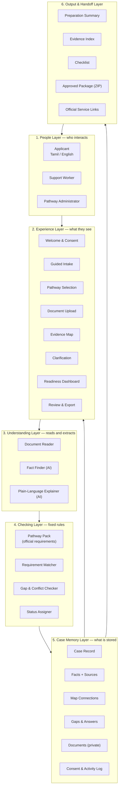
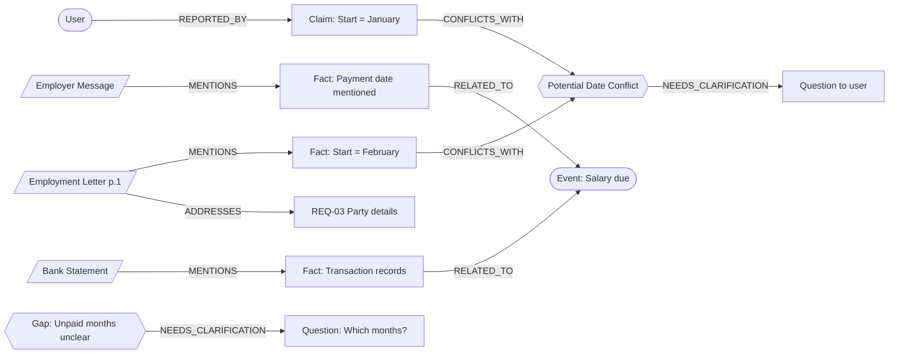
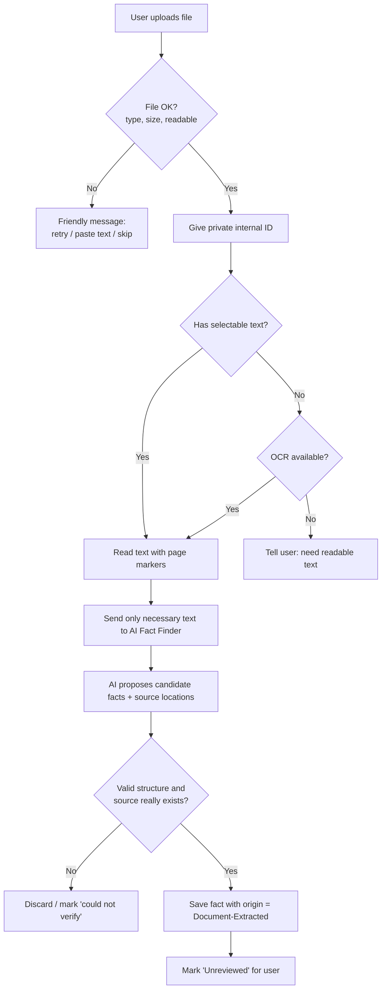
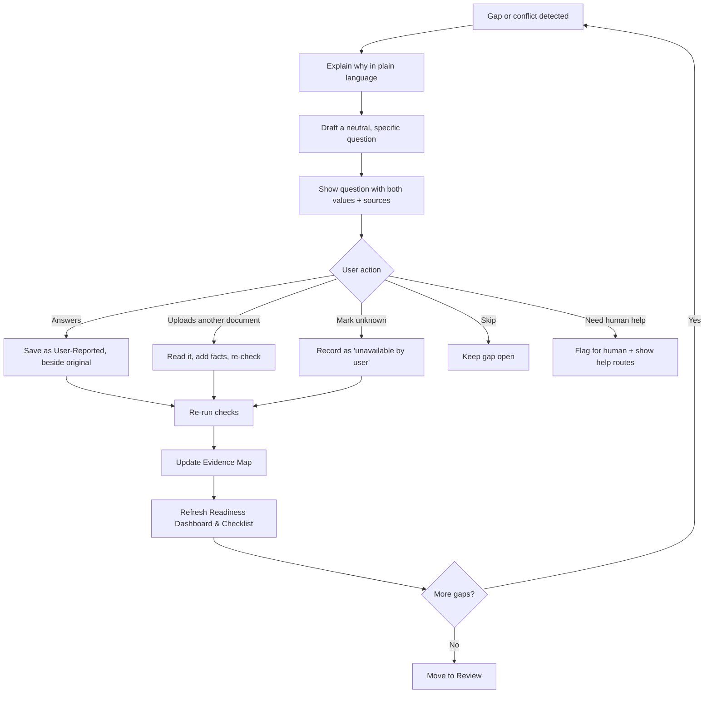
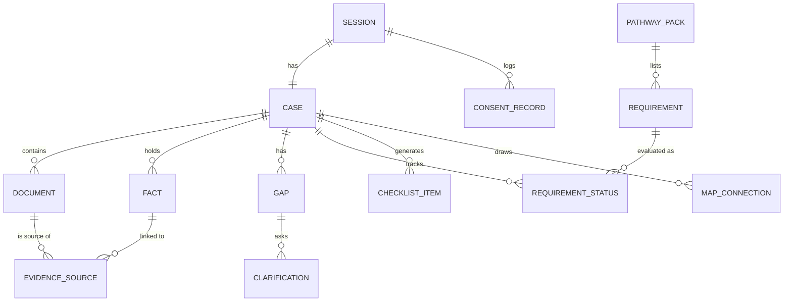

# Nyaya Saarathi — Complete Working System Design

**AI-Powered Evidence Map and Legal-Aid Preparation Assistant**
*Find the missing pieces. Organize the evidence. Take the next step.*

> This document describes how the whole system **works and behaves** — who uses it, what they see, what happens at each step, what the rules are, and how the parts fit together. It is written as a product and system design, not as code.
>
> **What this design combines:**
> - **Nyaya Saarathi's engine** — the Evidence Map, source-linked facts, conflict detection, and the Gap-to-Question loop.
> - **Thunai's requirement layer** — a small, officially sourced, versioned set of requirements that every case is checked against, with clear status labels.

---

## Table of Contents

1. [The Idea in One Page](#1-the-idea-in-one-page)
2. [The Problem We Are Solving](#2-the-problem-we-are-solving)
3. [Who Uses the System](#3-who-uses-the-system)
4. [Design Principles (The Rules the Whole System Follows)](#4-design-principles)
5. [The Big Picture: How the System Is Organized](#5-the-big-picture)
6. [The Core Concepts](#6-the-core-concepts)
7. [The Complete User Journey, Step by Step](#7-the-complete-user-journey)
8. [Screen-by-Screen Design](#8-screen-by-screen-design)
9. [The Pathway Pack (Requirement Library)](#9-the-pathway-pack)
10. [The Evidence Map in Detail](#10-the-evidence-map-in-detail)
11. [How Documents Are Read and Facts Are Found](#11-how-documents-are-read)
12. [How Gaps and Conflicts Are Detected](#12-gaps-and-conflicts)
13. [The Gap-to-Question Loop](#13-the-gap-to-question-loop)
14. [The Requirement Status System and Readiness Dashboard](#14-status-system-and-dashboard)
15. [Role of AI vs. Role of Fixed Rules](#15-ai-vs-rules)
16. [The Agent: What It Does and Never Does](#16-the-agent)
17. [Outputs: What the User Takes Away](#17-outputs)
18. [Official Handoff and Human Support](#18-handoff)
19. [The Support Worker View](#19-support-worker-view)
20. [The Admin / Maintainer View](#20-admin-view)
21. [Data the System Keeps](#21-data-the-system-keeps)
22. [Privacy, Safety and Trust Design](#22-privacy-safety-trust)
23. [Error Handling and Edge Cases](#23-error-handling)
24. [Language, Accessibility and Tone](#24-language-accessibility)
25. [Testing and Evaluation Plan](#25-testing-and-evaluation)
26. [One-Day Build Plan and Team Roles](#26-build-plan)
27. [The Demo: Script and Key Moment](#27-the-demo)
28. [Pitch Material](#28-pitch)
29. [Roadmap Beyond the Hackathon](#29-roadmap)
30. [Glossary](#30-glossary)

---

## 1. The Idea in One Page

**Nyaya Saarathi** is a *preparation assistant*. It helps a person who has a legal or administrative problem get organized **before** they approach a legal-aid service, a support worker, or an official portal.

The person tells their story in plain language and shares whatever papers they have. The system:

1. **Reads** the papers and pulls out the important details (dates, amounts, names, events).
2. **Remembers where each detail came from** (which document, which page, which line — or "the user said it").
3. **Compares** the details across documents and against what the user said.
4. **Checks** everything against a short, officially sourced list of requirements for the selected pathway.
5. **Shows** all of this as a visual **Evidence Map** and a **Readiness Dashboard**.
6. **Asks** the user simple, neutral questions about anything missing or inconsistent.
7. **Updates** the map as the user answers — never overwriting what was originally found.
8. **Produces** a reviewable package (summary, evidence index, checklist, selected documents) and **links** to the right official services.

**What it is not:** it is not a lawyer, it gives no legal advice, it does not decide eligibility, it does not predict outcomes, it does not file anything. It makes the preparation stage **clearer, traceable, and reviewable**.

**One-line pitch:** *From a pile of confusing papers to a clear, source-linked, review-ready preparation package.*

---

## 2. The Problem We Are Solving

People facing a legal problem (unpaid wages, a denied benefit, a dispute, being a crime victim seeking compensation) often *do* have records — letters, receipts, messages, bank statements, notices. But they struggle because:

| Struggle | What it feels like |
|---|---|
| **Jargon** | Official forms and notices are hard to understand. |
| **Scattered information** | Papers, photos, chat messages, and memories are all in different places. |
| **Not knowing what is missing** | "Do I have everything? What would they ask me?" |
| **Inconsistencies** | A date on the letter is different from the date I remember. I don't notice until it causes trouble. |
| **No traceability** | A normal chatbot gives a summary but can't show *where* each statement came from. |
| **No next step** | Even when organized, they don't know who to approach or what to prepare. |

**The real gap is not "people can't read documents."** It is that people can't easily see **how their information connects, what is unresolved, and what to do next.**

> **Honesty note for the pitch:** This is a *hypothesis* until validated. The system should be shown to at least one legal-aid volunteer, paralegal, or law student before claiming it solves a proven problem.

---

## 3. Who Uses the System

### 3.1 Primary users
- **The Applicant** — a person (or a family member/representative helping them) preparing to seek help. May be a first-time user, may have low digital comfort, may prefer Tamil.

### 3.2 Supporting users
- **Support Workers / Legal-Aid Volunteers / Paralegals** — help applicants organize information; can review the unresolved items and the package.
- **Qualified Legal-Aid Professionals** — validate the requirement lists and review unresolved questions (outside the app; the app is built to hand off to them).

### 3.3 System maintainers
- **Pathway Administrators** — authorized team members who maintain the officially sourced requirement packs, source links, and version dates.

### 3.4 What each user needs

| User | Main need | What the system gives them |
|---|---|---|
| Applicant | "Help me understand and get ready." | Plain-language guidance, a clear map, a checklist, a package |
| Support worker | "Show me quickly what this person has and what is unresolved." | A structured case view with sources and open questions |
| Legal professional | "Don't make me dig through a mess." | A traceable evidence index and flagged issues |
| Administrator | "Keep the rules accurate and current." | A controlled place to update requirements with source and version |

---

## 4. Design Principles

These are the rules every part of the system obeys. They are the heart of the design.

1. **Preparation, not advice.** The system organizes and explains. It never says "you will win," "you are eligible," or "you should sue."
2. **Every fact has an origin.** Each detail is labeled as either **User-Reported** or **Document-Extracted**, and (if from a document) points to the document and page/excerpt.
3. **Never silently choose.** When two values disagree, both are shown with their sources. The system does not pick a "correct" one.
4. **Never overwrite originals.** User clarifications are stored *beside* the original facts, not over them.
5. **Uploaded does not mean sufficient.** Having a document does not mean it satisfies a requirement legally. The system says "found" or "needs human confirmation," never "approved."
6. **Official sources only for rules.** Requirements shown to users come from a reviewed, versioned pack tied to an official source — not from the AI's imagination.
7. **AI proposes, rules decide.** AI reads language and suggests facts. Fixed, predictable rules decide statuses, gaps, and conflicts.
8. **Honest uncertainty.** If the system isn't sure, it says so and routes to a human.
9. **User stays in control.** The user reviews, corrects, approves, and chooses what is exported. Nothing leaves without approval.
10. **Collect the minimum.** Ask only for what the selected pathway needs. Avoid unnecessary sensitive questions.
11. **A human route is always visible.** Especially for urgent, unsafe, or complex situations.
12. **No outcome claims.** No case-strength score, no probability of compensation, no legal-merit rating.

---

## 5. The Big Picture

### 5.1 The system as six layers



### 5.2 How information flows (in words)

1. The **applicant** tells the story and uploads papers through the **screens**.
2. The **Document Reader** turns papers into readable text with page markers.
3. The **Fact Finder (AI)** proposes candidate facts, each tied to a source location.
4. The **Checking Layer** takes those facts and:
   - compares them to each other (conflicts),
   - compares them to the **Pathway Pack** (requirements),
   - assigns **statuses** and finds **gaps**.
5. Everything is saved in **Case Memory** with origin labels.
6. The **Evidence Map** and **Dashboard** are drawn from Case Memory.
7. Gaps become **questions**; answers go back into Case Memory (as user-reported), and the map and dashboard refresh.
8. When the user is satisfied, they **approve**, and the **Output Layer** builds the package and shows official links.

### 5.3 The two "engines" inside the Checking Layer

| Engine | Question it answers | Source of truth |
|---|---|---|
| **Consistency Engine** (from Nyaya Saarathi) | "Do the details agree with each other?" | The facts themselves |
| **Requirement Engine** (from Thunai) | "Which official requirements have supporting information, and which don't?" | The officially sourced Pathway Pack |

Together: *"Is the story consistent?"* **and** *"Does it cover what the official process asks for?"*

---

## 6. The Core Concepts

Learn these eight ideas and the whole system makes sense.

### 6.1 Case
One person's preparation file for one pathway. Contains the story, facts, documents, map, gaps, answers, and outputs. Anonymous by default (no login needed for the demo).

### 6.2 Pathway
A specific kind of legal-aid or compensation process the system *actually supports* — e.g., "Unpaid Wages Complaint Preparation." Only supported pathways can be chosen. If nothing fits, the system routes to a human instead of guessing.

### 6.3 Pathway Pack
A reviewed bundle for one pathway: its official source links, responsible authority, version/date, list of requirements, what documents are commonly relevant, and the plain-language wording. (Detailed in §9.)

### 6.4 Fact
One specific piece of information — e.g., "Start date = 1 Feb 2026." Every fact has:
- a **value**,
- an **origin** (User-Reported or Document-Extracted),
- a **source** (document + page + excerpt, or "user's own words"),
- a **review status** (Unreviewed / Confirmed by user / Corrected by user).

### 6.5 Requirement
One item from the Pathway Pack — e.g., "Details of the employer." Each requirement gets a **status** (see §14).

### 6.6 Gap
Something missing or unclear. Two types: **Missing** (nothing provided) and **Conflict** (two values disagree).

### 6.7 Clarification
A neutral question the system asks about a gap, and the user's answer.

### 6.8 Evidence Map
The visual, connected view of people, organizations, events, documents, facts, gaps, and clarifications — with labeled relationships. It makes information **inspectable**; it is **not a verdict**.

---

## 7. The Complete User Journey

A narrative of what happens from the first click to the final download.

### Stage 1 — Welcome, Language and Consent
- The user opens the app and chooses **Tamil** or **English**.
- The system explains in simple words:
  - what it does (helps organize and prepare),
  - what it does **not** do (no legal advice, no eligibility decision, no filing),
  - what happens to their documents (where processed, what is stored, how to delete),
  - that document text may be processed by an AI service.
- The user **chooses whether to continue** and understands they decide what to share.
- *Consent is recorded* (timestamp, language, version of the notice shown).

### Stage 2 — Tell Your Story (Guided Intake)
- A friendly prompt: *"In your own words, what happened?"*
- The user types (or later, speaks) freely.
- The system then asks a **few** targeted questions — only what the pathway needs (e.g., approximate dates, who the other party is).
- It deliberately **avoids** sensitive or irrelevant questions (no identity numbers required).
- Everything the user says is stored as **User-Reported**.

### Stage 3 — Pathway Selection
- The system suggests which supported pathway seems to match and shows it as a card.
- The card displays:
  - pathway name,
  - the **official source** and **responsible authority**,
  - the **source date/version**,
  - a plain-language "what this process is about."
- The user **confirms** the pathway or chooses another.
- **If the system can't confidently match** → it shows "We're not sure this fits a supported pathway" and offers **human help links** instead of guessing.

### Stage 4 — Understand the Requirements
- The system shows the pathway's requirements **in plain language** (Tamil/English).
- Each one has a **"See official wording"** link to its source.
- A short, neutral note: *"These are the things the official process commonly asks about. Having them does not guarantee any outcome."*

### Stage 5 — Share Your Documents
- The user uploads documents or pastes text (letters, messages, receipts, statements).
- The system shows each file's progress: *received → reading → facts found* (or *couldn't read — try another format*).
- The user can remove or retry any file.
- Documents are kept private to this session.

### Stage 6 — The System Builds the Picture
Behind the scenes (the user sees a friendly progress view):
1. Text is read from each document, keeping page markers.
2. Candidate facts are found and tied to sources.
3. Facts are compared with each other and with the user's story.
4. Facts are matched against the Pathway Pack requirements.
5. Gaps and conflicts are identified.
6. The Evidence Map and Dashboard are built.

### Stage 7 — Explore the Evidence Map
- The user sees a connected picture. Clicking any item opens a detail panel (value, source, origin, connections, related gaps).
- Conflicts are highlighted **neutrally** (amber "needs review," never red "wrong").
- The user can **inspect the source**, **correct an extraction mistake**, or **mark an item reviewed**.

### Stage 8 — Answer Clarification Questions
- One question at a time, in plain language, e.g.:
  - *"Your letter says work started on 1 February, but you mentioned January. Which date would you like us to record as your recollection?"*
  - *"Which months was salary not received?"*
- For each, the user can **Answer**, **Upload another document**, **Mark unknown**, **Skip**, or **Ask for human help**.
- Answers are saved as **User-Reported**, beside the original facts. The map and dashboard update instantly.

### Stage 9 — Review the Readiness Dashboard
- Shows every requirement with its **status** and **source link**.
- Shows unresolved questions and the user's chosen next actions.
- Shows progress **without** any eligibility or probability language.

### Stage 10 — Review, Edit and Approve
- The user reads the **plain-language summary** and can edit it.
- They check the **evidence index** and select which documents to include.
- They tick an **explicit approval** box.

### Stage 11 — Export and Handoff
- The system builds the **approved package** and offers a download.
- It shows **verified official links** and **human-support routes**.
- It reminds the user: *this does not file anything; you or an authorized person continues through the official process.*

### Stage 12 — Delete (Anytime)
- A visible **"Delete my session"** button removes the case, facts, and files.

### Journey at a glance


---

## 8. Screen-by-Screen Design

Design goal: **calm, simple, trustworthy.** Large text, plain words, one main action per screen, a persistent "Get human help" link and "Delete my session" link.

### Screen 1 — Welcome & Consent
| Element | Details |
|---|---|
| Language toggle | Tamil / English, always visible |
| Purpose statement | 3 short lines |
| "What I do / What I don't do" | Two-column simple card |
| Privacy summary | Where data goes, how to delete |
| Disclaimer banner | "Not a lawyer. No legal advice." |
| Action | **Start** (after reading) |

### Screen 2 — Tell Your Story
| Element | Details |
|---|---|
| Large text box | "In your own words, what happened?" |
| Optional helper chips | "Unpaid salary," "Notice received," etc. |
| Guided follow-ups | 2–4 short questions based on pathway |
| Skip option | "I don't know / prefer not to say" on every question |
| Voice input | Optional, only if reliable |

### Screen 3 — Choose Pathway
| Element | Details |
|---|---|
| Suggested pathway card | Name, authority, source, version/date |
| "Why this?" | One-line plain explanation |
| Alternatives | Other supported pathways |
| "None fit" | Leads to Human Help screen |

### Screen 4 — Requirements Explained
| Element | Details |
|---|---|
| Requirement list | Plain-language, numbered |
| Per item | "Official wording" link, "Why this matters" one-liner |
| Neutral banner | "Not a guarantee of any outcome" |

### Screen 5 — Upload Documents
| Element | Details |
|---|---|
| Drop zone | Supported types and size limits shown |
| File list | Name, status chip, remove / retry |
| Paste text | For messages and copied text |
| Synthetic-data note (demo) | "Demo uses sample documents only" |
| AI-processing notice | Shown clearly near upload |

### Screen 6 — Evidence Map
| Element | Details |
|---|---|
| Map area | Nodes (Person, Organization, Event, Document, Fact, Gap, Clarification) with labeled connections |
| Colour/shape legend | Simple, with text labels (not colour alone — accessibility) |
| Filters | "Show only gaps," "Show only conflicts," "Show timeline" |
| Detail panel | On click: value, origin, source & excerpt, review status, connected items, related questions |
| Actions | **View source**, **Correct this**, **Mark reviewed** |
| Fallback view | **Connected cards** list (if graph view is hard to read on small screens) |

### Screen 7 — Clarification
| Element | Details |
|---|---|
| Question card | One question at a time, with *why we're asking* |
| Context | The two conflicting values and their sources, side by side |
| Answer area | Text, date picker, or choice buttons |
| Buttons | **Answer · Upload document · I don't know · Skip · Need human help** |
| Result | "Map updated" with a visible before/after |

### Screen 8 — Readiness Dashboard
| Element | Details |
|---|---|
| Requirement table | Requirement · Status chip · Source · Linked facts/documents |
| Open questions list | With one-click "answer now" |
| Next-action list | User-selected tasks |
| Banner | "This shows preparation progress, not eligibility." |
| No score | No percent-chance, no "strength" rating |

### Screen 9 — Review & Export
| Element | Details |
|---|---|
| Editable summary | Plain-language, factual, with sources noted |
| Evidence index | Table of facts + sources |
| Document picker | Choose which files go in the package |
| Approval checkbox | "I reviewed this and want to export it." |
| Download | ZIP (and optional PDF of summary) |
| Official links panel | Verified services and human-support routes |

### Screen 10 — Human Help (always reachable)
| Element | Details |
|---|---|
| Plain message | "It's okay to ask a person. Here's where." |
| Routes | Legal-aid authority links, helplines (verified), "talk to a support worker" |
| Urgent safety note | For emergencies, contact local emergency services |

---

## 9. The Pathway Pack

This is the **Thunai layer** — what makes checklists trustworthy instead of invented.

### 9.1 What a Pathway Pack contains

| Part | Description |
|---|---|
| **Pathway name** | e.g., "Unpaid Wages — Preparing to Approach Legal Aid / Labour Authority" |
| **Responsible authority** | The official body concerned |
| **Official source links** | The pages the requirements come from |
| **Source version/date** | When the pack was last checked against the sources |
| **Reviewed by / review date** | Who verified it (a name or "pending review") |
| **Requirement list** | Each requirement (see 9.2) |
| **Commonly relevant documents** | Types of records that often relate to each requirement |
| **Plain-language text** | Tamil and English wording for each requirement |
| **Handoff links** | Verified official service links for next steps |
| **Not-applicable rules** | Only where the official source supports "not applicable" |

### 9.2 What one requirement looks like

| Field | Example (illustrative — **must be verified against official sources**) |
|---|---|
| ID | REQ-03 |
| Title | Details of the employer or other party |
| Plain-language explanation | "The process usually asks who you worked for and how to identify them." |
| What counts as "information found" | A named party has been given by the user or found in a document |
| Related fact types | party name, party address, party role |
| Commonly relevant documents | Appointment letter, messages from the party |
| Official source reference | Link + section/page |
| Needs human confirmation? | Yes/No (e.g., "whether this document is legally sufficient") |

> ⚠️ **Important:** The example requirement texts in this document are **illustrations of structure only**. The real list must be written during **Hour 0–1** by reading the official sources, and displayed with source and date. Never ship invented requirements.

### 9.3 Choosing the demo pathway

| Option | Pros | Cons |
|---|---|---|
| **Unpaid wages** (recommended for demo) | Safe with synthetic data; easy planted date conflict; relatable | Need to ground requirements in a real labour/legal-aid source |
| **Victim compensation** (Thunai's original) | Strong emotional impact; clear official scheme | High sensitivity; wrong requirement could mislead vulnerable people |

**Recommended:** Build the *engine* generically; ship **one** pathway pack for the demo (wages), and show the victim-compensation pack as a **"next pathway" slide** to demonstrate the design scales. If the team strongly prefers victim compensation, use it **only with synthetic data** and strong human-handoff messaging.

### 9.4 Pack lifecycle
1. **Draft** — Administrator writes requirements from official sources.
2. **Review** — A knowledgeable person checks them.
3. **Published** — Version and date stamped; becomes selectable.
4. **Superseded** — If official sources change, a new version is published; old cases keep the version they were prepared against.
5. **Retired** — No longer shown to new users.

---

## 10. The Evidence Map in Detail

### 10.1 What it is
A connected picture of everything in the case. Think of it as a **case wall with strings**: sticky notes (items) joined by labeled strings (relationships), where each sticky note shows where its information came from.

### 10.2 Items (Nodes)

| Item type | Represents | Example |
|---|---|---|
| **Person** | A person in the story | The applicant; a manager |
| **Organization** | A company or institution | The employer named in a letter |
| **Event** | Something reported to have happened | "Work started"; "Salary became due" |
| **Document** | An uploaded or pasted source | Employment letter; bank statement; message |
| **Fact / Claim** | A specific statement from a source or user | "Start date: 1 Feb 2026 (letter)" |
| **Gap / Conflict** | Something missing or inconsistent | "Two different start dates" |
| **Clarification** | A question and the user's answer | "Which months unpaid?" → "March–May" |
| **Requirement** *(new from Thunai)* | An item from the Pathway Pack | "REQ-03 Details of the party" |

### 10.3 Relationships (Edges)

| Relationship | Plain meaning | Example |
|---|---|---|
| **MENTIONS** | A source contains a detail | Letter → mentions a start date |
| **REPORTED_BY** | The user said it | Start-date claim → reported by user |
| **SUPPORTED_BY** | A source passage is relevant to a fact | Fact → linked to a passage |
| **RELATED_TO** | Same topic or event | Salary due → payment records |
| **CONFLICTS_WITH** | Two values seem inconsistent | User date ↔ letter date |
| **NEEDS_CLARIFICATION** | Requires review | Conflict → question |
| **ANSWERED_BY** | A gap has a response | Missing months → user's answer |
| **OCCURRED_BEFORE** | Timeline order | Work started → salary due |
| **ADDRESSES** *(new)* | A fact/document is relevant to a requirement | Letter → addresses REQ-03 |

> **SUPPORTED_BY / ADDRESSES mean "relevant to," not "proves."**

### 10.4 Example map (unpaid wages)



### 10.5 Detail panel (when an item is clicked)
- Type and label
- Value (and normalized form, e.g., a date)
- **Origin** badge: *User-Reported* / *Document-Extracted*
- **Source:** document name, page, excerpt (with "View source")
- **Review status:** Unreviewed / Confirmed / Corrected
- Connected items and relationship names
- Linked requirements
- Related gap or question
- Actions: **Inspect source · Correct extraction · Mark reviewed**

### 10.6 Visual rules
- **Conflicts:** amber, labeled "Needs review."
- **Missing:** dashed outline, labeled "Missing."
- **User-reported:** one icon; **Document-extracted:** another icon (so origin is visible without colour).
- **Nothing is ever shown in a way that implies guilt, truth, or fault.**

### 10.7 Map views
| View | Purpose |
|---|---|
| **Full map** | Whole picture |
| **Timeline view** | Events in order (uses OCCURRED_BEFORE) |
| **Gaps-only view** | What needs attention |
| **By-requirement view** | For each requirement, the connected evidence |
| **Card view** | Simple list fallback for small screens |

---

## 11. How Documents Are Read

### 11.1 What types are supported

| Input | MVP handling |
|---|---|
| Text-based PDF | Supported (text read directly, page numbers kept) |
| Pasted text / chat messages | Supported |
| Scanned PDF / photo | **Optional later** (needs OCR). If unavailable, user is told clearly and asked for readable text. |

### 11.2 Document handling flow



### 11.3 What the Fact Finder looks for
Only what the pathway needs, such as:
- **Dates** (start, end, payment, notice)
- **Amounts** (salary, dues, payments)
- **Parties** (names of people/organizations and roles)
- **Events** (start of work, a payment promise, a notice)
- **Document type** (letter, message, statement)

### 11.4 Rules for extraction
- Each fact **must** point to a real page/excerpt. If not locatable, it is marked "location unavailable" — it is never invented.
- If the AI output is malformed or doesn't match the expected structure, it is **rejected**, not repaired by guessing.
- Facts start as **Unreviewed**; the user can confirm or correct.
- Raw document text is **not** written to general logs.

---

## 12. Gaps and Conflicts

### 12.1 Two kinds of gaps

| Kind | Meaning | System reaction |
|---|---|---|
| **Missing** | A needed detail wasn't found or given | Create a checklist item + a question |
| **Conflict** | Two values for the same thing disagree | Show both side by side + a question |

A third category sits alongside:

| Kind | Meaning | System reaction |
|---|---|---|
| **Needs human confirmation** | Something only a professional can judge (e.g., "is this document sufficient?") | Flag for human review; no judgment made |

### 12.2 How conflicts are decided (plain language)
1. Take two facts of the **same type** (e.g., two start dates).
2. **Normalize** them (e.g., "01/02/26", "1 Feb 2026", "February 1st 2026" all become one standard date; "₹15,000" and "15000" become one number).
3. If they match → **consistent**.
4. If one is missing → **needs clarification**.
5. If they differ → **potential conflict**.

### 12.3 What the system will *not* do
- Compare unrelated things.
- Treat harmless formatting differences as conflicts.
- Decide who is right.
- Treat a missing document as proof an event didn't happen.
- Treat a conflict as proof of wrongdoing by anyone.

### 12.4 Supported comparisons in the MVP
| Comparison | Example |
|---|---|
| Date vs. date | User start date vs. letter start date |
| Amount vs. amount | Stated salary vs. salary in a document |
| Party name vs. party name | Employer named differently in two documents |
| Period vs. period | Months claimed vs. months in records |

### 12.5 Missing-information rules
Driven by the Pathway Pack. For each requirement, the pack lists what facts would count as "information found." If none exist → **Missing** → a checklist item and (when helpful) a question.

---

## 13. The Gap-to-Question Loop

The signature interaction of the whole system:

> **Find a gap → explain it → ask the user → record the answer → update the map → refresh the checklist.**

### 13.1 Loop in detail



### 13.2 Question-writing rules
- **Neutral:** never suggests which value is right.
- **Specific:** one thing at a time.
- **Plain:** simple words, Tamil or English.
- **Shows evidence:** displays the sources involved.
- **Optional:** user can always skip or say "I don't know."
- **No pressure:** no "you must," no implication of consequences.

### 13.3 Good vs. bad question examples

| ❌ Avoid | ✅ Prefer |
|---|---|
| "Your letter proves you're wrong about the date. Which is correct?" | "We found two dates. Your message says January; the letter (page 1) says February. Which would you like us to note as your recollection?" |
| "You must provide your payslips." | "We didn't find payslips. If you have any, you can upload them. If not, you can mark this as unavailable." |
| "Why did you lie about the amount?" | *(Never.)* "The amounts differ: ₹15,000 and ₹12,000. Can you tell us about the difference?" |

### 13.4 The "before and after" principle
After every answer the screen shows a small **"What changed"** note:
- *Added:* user's answer (User-Reported).
- *Unchanged:* original document-extracted values.
- *Updated:* gap status, map connections, dashboard.

This is the key trust-building moment.

---

## 14. Status System and Dashboard

### 14.1 The statuses (for each requirement)

| Status | Meaning | Chip text (plain) |
|---|---|---|
| **Information found** | Something relevant was provided or found | "Information found" |
| **Missing information** | Nothing relevant yet | "Not yet provided" |
| **Needs your clarification** | Conflicting or unclear details exist | "Please clarify" |
| **Needs human confirmation** | Only a qualified person can judge | "Ask a person to confirm" |
| **Not applicable** | Official rules support this status | "May not apply" |
| **Marked unavailable by you** | User says they can't provide it | "You marked: not available" |

> **No status ever means** "approved," "sufficient," "eligible," or "will succeed."

### 14.2 How a status is assigned (plain rules)
In order:
1. If official rules say it doesn't apply to this case → **Not applicable**.
2. If conflicting facts relate to it → **Needs your clarification**.
3. If it relies on a judgment only a human can make → **Needs human confirmation** (can appear *together with* "Information found").
4. If relevant facts/documents exist → **Information found**.
5. If the user said it's unavailable → **Marked unavailable**.
6. Otherwise → **Missing information**.

These rules are fixed and predictable — the same inputs always give the same statuses.

### 14.3 Readiness Dashboard layout

| Section | Content |
|---|---|
| **Header** | Pathway name, source version/date, plain disclaimer |
| **Progress strip** | Counts per status (e.g., 5 found · 2 need clarification · 1 missing) — **counts, not a score** |
| **Requirement table** | Each requirement, status chip, source link, linked evidence |
| **Open questions** | List with "Answer now" |
| **Next actions** | Tasks the user selected |
| **Records that may help** | Suggestions of common documents (optional to gather) |

### 14.4 What the dashboard deliberately avoids
- Percentage "chance of success."
- A single "readiness score" that could be mistaken for eligibility.
- Red/green "pass/fail" visuals.

---

## 15. AI vs. Fixed Rules

The cleanest way to understand the system's trustworthiness.

| Task | Who does it | Why |
|---|---|---|
| Understand the user's free-text story | **AI** | Language is messy |
| Simplify official wording into plain language | **AI** (constrained to the pack's text) | Needs fluency; must not change meaning |
| Propose candidate facts from documents | **AI** | Reading comprehension |
| Draft neutral clarification questions | **AI** (within templates and rules) | Natural wording |
| Translate between Tamil and English | **AI** (with reviewed key phrases) | Language task |
| Decide which requirements exist | **Reviewed Pathway Pack** | Must be official, not AI-made |
| Normalize dates and amounts | **Fixed rules** | Must be exact |
| Compare values and flag conflicts | **Fixed rules** | Must be predictable |
| Detect missing requirements | **Fixed rules** | Must be predictable |
| Assign statuses | **Fixed rules** | Must be consistent and explainable |
| Decide what is exported | **The user** | Control and consent |
| Judge legal sufficiency or merit | **A human professional** | Outside the system's scope |

**Golden rule:** *AI interprets language. Rules decide statuses. Humans decide everything legal.*

### 15.1 Guardrails on the AI
- It only sees the text it needs.
- Its output must fit a strict structure or is rejected.
- Every fact it proposes must point to a real source location.
- It is forbidden from: giving legal opinions, picking the "right" value, predicting outcomes, inventing requirements, or inventing deadlines.
- If uncertain, it marks the item **"uncertain — needs review."**

---

## 16. The Agent

The "agent" is the coordinator that runs the workflow using a fixed set of capabilities. It is **not** free-roaming; it can only use the capabilities listed below.

### 16.1 Capabilities (what the agent can do)

| Capability | Plain description |
|---|---|
| **Read a document** | Get text and page locations |
| **Find facts** | Propose structured facts with sources |
| **Compare facts** | Flag potential conflicts |
| **Look up requirements** | Fetch the pathway's requirement list |
| **Match evidence to requirements** | Link facts/documents to requirements |
| **Draft questions** | Write neutral questions for gaps |
| **Save user answers** | Store separately from extracted facts |
| **Build checklist** | Create preparation tasks |
| **Build the map** | Assemble items and relationships |
| **Create the package** | Assemble approved export |

### 16.2 The agent's working order
1. Receive the story and chosen pathway.
2. Read selected documents.
3. Find candidate facts and validate them.
4. Save facts with origin labels.
5. Run conflict and missing-information checks.
6. Match to requirements and assign statuses.
7. Draft questions for open gaps.
8. Wait for the user; save answers separately.
9. Rebuild map, statuses, and checklist.
10. Prompt the user to review.
11. Export only after explicit approval.

### 16.3 What the agent never does
- Gives legal advice or opinions on merit.
- Chooses between conflicting values.
- Predicts outcomes or scores a case.
- Declares eligibility.
- Treats extracted statements as proven.
- Invents legal requirements, procedures, or deadlines.
- Claims anything was filed or accepted.
- Continues a risky conversation without offering human help.

### 16.4 When the agent hands off to a human
- The user's situation seems **urgent or unsafe**.
- The pathway can't be confidently identified.
- A requirement needs professional judgment.
- The user asks for legal advice or outcome predictions.
- The user seems distressed or confused.
- Extraction repeatedly fails.

---

## 17. Outputs

Everything the user can take away. All are **reviewed and approved by the user** before export.

### 17.1 Plain-Language Summary
- A factual, neutral description of the case as the user has presented it.
- Uses careful wording: *"The letter states…"*, *"You reported…"*.
- Marks unresolved items clearly.
- Fully editable by the user.
- **Never** contains legal conclusions.

### 17.2 Evidence Index
A table: **Fact · Value · Origin · Source document · Page/excerpt · Review status.**
Conflicts show both values.

### 17.3 Requirement-to-Evidence Index
For each requirement: status, linked facts/documents, source reference, unresolved notes.

### 17.4 Readiness Checklist
- Completed items.
- Items still to gather/clarify.
- Records that may be useful.
- Items needing human confirmation.

### 17.5 Evidence Map Snapshot
An image or simple diagram of the map at export time (optional).

### 17.6 Approved Package (ZIP)

```
Nyaya_Saarathi_Preparation_Package/
├── 01_Summary                  (user-approved, plain language)
├── 02_Evidence_Index
├── 03_Requirement_to_Evidence_Index
├── 04_Checklist
├── 05_Evidence_Map_Snapshot    (optional)
├── 06_Selected_Documents/      (only those the user picked)
├── 07_Official_Links_and_Next_Steps
└── README   (what this package is and is not)
```

### 17.7 The README inside the package says
- This was prepared with an assistive tool.
- It is **not legal advice**, does **not** confirm eligibility, and was **not submitted** to any authority.
- Statements are as reported by the user or as extracted from documents and may contain errors.
- Date prepared and the Pathway Pack version used.

---

## 18. Official Handoff

### 18.1 What the handoff screen shows
- **Where to go next** — verified official links for the selected pathway.
- **How to reach a person** — legal-aid authority contacts and helpline information (verified).
- **What to bring** — the package and any physical originals.
- **Reminder** — "You or an authorized person continues through the official process."

### 18.2 Link policy
- Every link is **verified** before the demo and shows a **"last checked"** date.
- If a link can't be verified, it is **not shown**.
- The app **never claims affiliation** with any official service unless formally established.
- The app **never** scrapes protected data or claims government integration.

### 18.3 Starting-point sources to verify
| Service | Use |
|---|---|
| NALSA | National legal-services information |
| NALSA legal-aid application portal | Where official applications are made |
| eCourts services | Court information |
| Nyaya Setu | Access-to-justice information |
| State Legal Services Authority pages | State-level information (e.g., Tamil Nadu) |
| NALSA Victim Compensation pages | If the victim-compensation pathway is added |

---

## 19. The Support Worker View

*(Post-MVP or a simple read-only mock for the demo.)*

### 19.1 Purpose
Help a volunteer or paralegal quickly understand an applicant's prepared case.

### 19.2 What the support worker sees
| Section | Content |
|---|---|
| **Case overview** | Pathway, language, date prepared, pack version |
| **Requirement table** | Statuses, linked evidence, source references |
| **Unresolved items** | Conflicts, missing items, "needs human confirmation" |
| **Evidence Map** | Same interactive map |
| **Applicant's answers** | Clearly labeled as User-Reported |
| **Notes** | Support worker can add notes (kept separate and labeled) |

### 19.3 Access rules
- Only with **explicit, time-limited permission** from the applicant.
- Support workers see only what the applicant chose to share.
- Everything a worker adds is labeled with its author role.
- Applicant can revoke access.

---

## 20. The Administrator View

*(Mostly a design for the future; for the hackathon, pack data can be prepared in a structured file.)*

### 20.1 What administrators manage
- Pathway Packs: requirements, plain-language text (Tamil/English), source links, version, review date.
- Verified official links and their "last checked" dates.
- Synthetic demo cases and expected results for testing.

### 20.2 Controls
- Draft → Review → Publish workflow.
- Version history (who changed what, when).
- A "source changed" flag to trigger re-review.
- No requirement can be published without an official source reference.

---

## 21. Data the System Keeps

Described by purpose, not technology.

| Data group | What it holds | Why | Kept for |
|---|---|---|---|
| **Session** | Language, anonymous ID, state | Remember progress | Until deleted / expiry |
| **Consent record** | Notice version shown, time, choices | Show informed choice | With the session |
| **Case** | Pathway, user's story, summary draft | The core file | Until deleted |
| **Documents** | File info + the private file itself | Source of facts | Until deleted |
| **Facts** | Value, normalized value, origin, review status | The information | Until deleted |
| **Evidence sources** | Document, page, excerpt for each fact | Traceability | Until deleted |
| **Map connections** | Relationships between items | The Evidence Map | Rebuilt from records |
| **Gaps** | Type, description, status | What needs attention | Until deleted |
| **Clarifications** | Question, answer, origin | The loop | Until deleted |
| **Requirement status** | Per requirement, per case | Dashboard | Until deleted |
| **Checklist items** | Tasks, status, source link | Preparation list | Until deleted |
| **Pathway Packs** | Requirements, sources, versions | The rules | Maintained by admins |
| **Activity log** | Minimal events (no document text) | Accountability | Short, limited |

### 21.1 Key data rules
- **Origin is always recorded** (User-Reported vs. Document-Extracted).
- **Originals are never overwritten**; corrections are recorded beside them with history.
- **The map is rebuilt from records**, so it can't drift from the facts.
- **Random internal IDs** are used, not names, in file naming.
- **Deleting a session deletes** its documents, facts, answers, and exports.

### 21.2 How records relate (simple view)



---

## 22. Privacy, Safety and Trust Design

### 22.1 Data minimization
- Ask only what the pathway needs.
- Do **not** require Aadhaar or other ID numbers.
- Let the user skip, say "unknown," or say "prefer not to say."

### 22.2 Demo safety
- **Only synthetic documents and people** in any public demo.
- A clear "Demo — sample data only" banner.
- No real victim or personal data stored during the hackathon.

### 22.3 Transparency
- Plain notice before starting.
- Clear statement when document text is processed by an external AI service.
- Visible "what we store" and "how to delete."

### 22.4 Access control
- Each session sees only its own records.
- Private storage; no public links to uploaded files.
- Support-worker access only via explicit, time-limited permission.

### 22.5 Security hygiene (non-technical summary)
- Secrets kept out of the code and out of shared files.
- File type, size, and integrity checks on uploads.
- Generated, random file names.
- No raw document text in general logs.
- Temporary files cleaned after export or deletion.
- No claim of production-grade security without proper review.

### 22.6 Retention and deletion
- **Delete my session** button always visible.
- Automatic expiry after a short period.
- Deletion removes documents, facts, answers, and exports.

### 22.7 Safety behavior
| Situation | System behavior |
|---|---|
| User describes immediate danger | Show emergency/safety message and human help routes first |
| User asks "Will I win?" | Politely explain it can't predict outcomes; offer human help |
| User asks "Am I eligible?" | Explain it can't decide; show what the official source says and who can confirm |
| User seems distressed | Gentle tone; offer to pause; show human support options |
| Pathway unclear | Don't guess; offer human help |
| Extraction uncertain | Mark "needs review"; don't present as fact |

### 22.8 Trust signals shown throughout
- "Not a lawyer" banner.
- Source link beside every requirement.
- Origin badge beside every fact.
- "Pack version / last checked" stamp.
- Preserved original values.
- Explicit approval before export.

---

## 23. Error Handling and Edge Cases

| Situation | What the user experiences |
|---|---|
| Unsupported file type | "We can't read this file type. Try a text-based PDF or paste the text." |
| File too large / corrupt | Friendly message, retry/skip |
| Scanned file, no OCR | "This looks like a scan. Please paste the text or upload a text-based PDF." |
| AI output malformed | Item marked "could not read reliably — please review"; no guessing |
| Fact has no locatable source | Marked "source location unavailable"; not hidden |
| Contradicting facts within one document | Shown as a conflict with both excerpts |
| User contradicts themselves | Both statements kept; clarification offered |
| User corrects an extraction | Original kept in history; corrected value shown with "Corrected by you" |
| User marks everything "unknown" | Dashboard reflects it honestly; human help offered |
| No requirement matches | Shown as Missing; never filled with invented evidence |
| Pack version changes mid-case | User sees "A newer version exists — review changes" |
| Connection lost mid-session | Progress restored from saved state |
| AI service unavailable | Fall back to manual entry of key fields and rule-based checks |
| User leaves and returns | Session resumes if not expired |
| Language mismatch (Tamil story, English docs) | Facts extracted regardless of language; shown in user's language |

---

## 24. Language, Accessibility and Tone

### 24.1 Languages
- **MVP:** Tamil and English for interface and explanations.
- Official wording stays in its original language with a link; the plain-language version is a *simplification*, never a replacement.
- Key legal/official terms are translated using a reviewed glossary so meaning stays stable.

### 24.2 Tone guidelines
- Warm, calm, respectful.
- Short sentences, everyday words.
- No blame, no pressure, no fear language.
- Explain *why* a question is being asked.
- Acknowledge that this may be a stressful time.

### 24.3 Accessibility
- Large readable text; high contrast.
- Not reliant on colour alone (icons and text labels).
- Keyboard-friendly navigation.
- Works on small phone screens (card view fallback for the map).
- Read-aloud and voice input as later enhancements.
- Low-bandwidth friendliness (light pages).

### 24.4 Example phrasing

| Instead of | Say |
|---|---|
| "Error: invalid document" | "We couldn't read this file. You can try another file or paste the text." |
| "Conflict detected!" | "We noticed two different dates. Let's look at them together." |
| "Eligibility check" | "Preparation check" |
| "Missing required document" | "We haven't found this yet. If you have it, you can add it." |

---

## 25. Testing and Evaluation Plan

### 25.1 Test with synthetic cases
Prepare **3–5 synthetic cases** with known expected results:
- **Case A:** Clean case (no conflicts, one missing item).
- **Case B:** Planted date conflict (the demo case).
- **Case C:** Amount mismatch.
- **Case D:** Messy/partial documents.
- **Case E:** User unsure about everything (tests "unknown" paths).

### 25.2 Functional checklist
- [ ] Text-based PDF uploads and is read.
- [ ] Unreadable file shows a clear message.
- [ ] Facts carry the right origin labels.
- [ ] Source references point to the correct page.
- [ ] Planted date discrepancy is flagged.
- [ ] Missing field creates a checklist item.
- [ ] User answer updates the map **without deleting** originals.
- [ ] Requirement statuses change correctly after answers.
- [ ] ZIP contains **only** approved, selected files.
- [ ] One session cannot see another's data.
- [ ] Delete-session removes everything.
- [ ] No eligibility/outcome language appears anywhere.

### 25.3 Quality measures
| Measure | What it tells us |
|---|---|
| Extraction accuracy (dates, amounts) | Is the Fact Finder reliable? |
| % facts with valid source references | Is traceability real? |
| Planted-conflict detection rate | Does the checker work? |
| Missing-field detection rate | Does the requirement engine work? |
| Unsupported-fact count | Is the AI inventing things? |
| Requirement-to-evidence mapping accuracy | Core Thunai measure |
| Time to produce a reviewable package vs. doing it manually | Practical value |
| User understanding of limits (quick questions) | Is it clear what the tool can't do? |

### 25.4 Honest reporting
Report **actual** results from the small synthetic test set. Do **not** claim reduced rejection rates, better case outcomes, or proven real-world impact without real evidence.

### 25.5 Validation with real people (when possible)
- Show the demo to a legal-aid volunteer, paralegal, or law student.
- Ask: *Is this a recurring problem? Would this save you time? What would you change?*
- Any testing with real applicants requires consent, privacy safeguards, and qualified oversight.

---

## 26. One-Day Build Plan and Team Roles

### 26.1 What to build vs. skip

| ✅ Build | ❌ Do not build initially |
|---|---|
| One pathway pack (verified) | Multiple unverified pathways |
| Story intake + consent | Real victim/user data |
| Text-PDF + pasted text reading | Mandatory OCR |
| Fact finding with sources | Legal merit or eligibility scoring |
| Conflict + missing checks | Government database claims |
| Evidence Map (cards or simple graph) | Automatic submission |
| Requirement statuses + dashboard | Multi-tenant production platform |
| Clarification loop | Complex user accounts |
| Summary + ZIP export | Elaborate styling |
| Verified official links | Live official integrations |

### 26.2 Timeline

| Hour | Focus | Result |
|---|---|---|
| **0–1** | Choose pathway, read official sources, write the pack, create synthetic documents with a planted conflict | Verified pack + test case + expected facts |
| **1–2** | Welcome, consent, intake, pathway card, upload screens | Front half of the flow |
| **2–4** | Document reading + fact finding + source references | Facts with sources |
| **4–6** | Conflict/missing checks + requirement matching + statuses | Dashboard data ready |
| **6–8** | Evidence Map + clarification loop with live updates | The "wow" moment works |
| **8–9** | Summary, evidence index, checklist, ZIP, official links | Exportable package |
| **9–10** | End-to-end testing, fix, rehearse demo, verify links | Demo-ready |

> This is aggressive. **One complete working flow beats many half-built features.** If time runs short, drop: voice, OCR, PDF export, fancy graph (use connected cards), second pathway.

### 26.3 Team roles (3 people)

| Role | Owns |
|---|---|
| **Member 1 — Experience & Demo** | All screens, Evidence Map display, detail panel, dashboard, review/export screen, demo flow and pitch visuals |
| **Member 2 — Data & Documents** | Case storage, uploads, document reading, storing facts/sources/connections, ZIP generation, clean-up and deletion |
| **Member 3 — Intelligence & Checking** | Pathway pack content, fact-finding instructions, conflict/missing rules, status rules, question drafting, synthetic documents, accuracy testing |

**Shared first task (Hour 0–1):** agree on the *fact format*, the *status names*, and the *list of capabilities* so work can be split cleanly. **Integrate early.** One person does final end-to-end verification.

### 26.4 Priority order if things go wrong
1. Intake → upload → facts with sources
2. Planted conflict detection + clarification loop + map update
3. Requirement statuses + dashboard
4. Summary + ZIP export
5. Evidence Map polish
6. Everything else

---

## 27. The Demo

### 27.1 The scenario (all synthetic)
A person says: *"My employer has not paid my salary for three months."*
They upload three sample documents:
1. **Employment letter** — start date **1 February**.
2. **Employer message** — mentions a payment date and a promise.
3. **Bank statement** — transaction records.

Their story says they started in **January** (the planted discrepancy). The months unpaid are **not stated** (the planted gap).

### 27.2 The key demo moment
> Show **both dates side by side with their sources**, ask the user a neutral question, accept the answer, and watch the map, the dashboard statuses, and the checklist update — **while the original letter date stays untouched.**

### 27.3 Demo script (about 5 minutes)

| Step | You say / show | What the audience sees |
|---|---|---|
| **1. Hook** | "People often have the papers but can't see the full picture." | Welcome screen |
| **2. Trust** | "It's not a lawyer. It tells you what it can't do." | Consent and disclaimer |
| **3. Story + pathway** | Type the story; pick the wages pathway | Pathway card with **official source and version/date** |
| **4. Requirements** | "These come from the official source, not the AI." | Plain-language requirements with links |
| **5. Upload** | Add 3 sample documents | Progress → facts found |
| **6. Evidence Map** | "Every fact shows where it came from." | Click a fact → source page + excerpt |
| **7. Conflict** | "Two different start dates — we don't pick one." | Amber conflict with both sources |
| **8. Clarify** | Answer the question; also answer "which months?" | **Map and dashboard update; original value preserved** |
| **9. Dashboard** | "Statuses, not scores. We never say eligible." | Requirement table with chips |
| **10. Export** | Review, approve, download | ZIP + official links |
| **11. Close** | "We make the preparation stage clearer, traceable, and reviewable." | Final slide |

### 27.4 Likely judge questions and answers

| Question | Answer |
|---|---|
| "How do you know the checklist is right?" | "It comes from a versioned pack tied to an official source, shown to the user. We flag it as pending professional review." |
| "Is this just a chatbot?" | "No. Facts are source-linked, comparisons are rule-based, statuses are deterministic, and the user answers gaps that update a live map." |
| "What if the AI makes things up?" | "Every fact must point to a real location or is rejected; the AI never decides statuses." |
| "Is this legal advice?" | "No. It organizes information and routes to humans." |
| "What about privacy?" | "Synthetic data for the demo, minimal collection, delete button, no public file links, disclosure of AI processing." |
| "Is it novel?" | "We propose the combination — source-linked evidence mapping, requirement mapping, and a gap-resolution loop. We haven't claimed no one has similar features; we're validating with practitioners." |
| "What's the impact?" | "Unproven; our plan is to test with volunteers and measure preparation time and clarity." |

---

## 28. Pitch Material

**Problem (one line):** People have documents but can't see how they connect, what's missing, or what to do next.

**Solution (one line):** Nyaya Saarathi turns a person's story and papers into a source-linked Evidence Map, checks it against officially sourced requirements, and guides them through resolving gaps — producing a reviewable package for human help.

**Differentiators**
1. Every fact traceable to its source.
2. User statements and document facts kept separate.
3. Conflicts shown, never silently resolved.
4. Requirements come from official, versioned sources.
5. A gap-to-question loop that updates a live map.
6. User-approved package and verified official handoff.
7. Tamil and English plain-language support.

**What we deliberately do not do:** advise, predict, score, decide eligibility, submit applications.

**Closing line:** *"Nyaya Saarathi helps people see what their information contains, where it came from, and what still needs clarification — before they approach official support."*

---

## 29. Roadmap Beyond the Hackathon

| Phase | Additions |
|---|---|
| **Next** | OCR for scanned documents; voice intake and read-aloud; more complete graph visuals |
| **Then** | Second pathway (victim compensation) with practitioner-reviewed requirements; more languages |
| **Later** | Support-worker review portal with permission-based sharing; administrator tooling for packs |
| **Eventually** | Stronger privacy/security review and accessibility testing; official integrations only where authorized; evaluation studies with consent and oversight |

---

## 30. Glossary

| Term | Meaning |
|---|---|
| **Evidence Map** | Connected visual of people, events, documents, facts, gaps, and questions |
| **Pathway** | A supported official process the tool prepares users for |
| **Pathway Pack** | Reviewed, versioned bundle of requirements, sources, and wording for one pathway |
| **Requirement** | One item the official process asks about |
| **Fact** | One specific piece of information with a value, origin, and source |
| **Origin** | Whether a fact is User-Reported or Document-Extracted |
| **Gap** | Missing or conflicting information |
| **Potential conflict** | Two values that appear inconsistent and need review |
| **Clarification** | A neutral question about a gap, plus the user's answer |
| **Gap-to-Question Loop** | Find gap → explain → ask → record → update map → refresh checklist |
| **Status** | A requirement's current preparation state (e.g., Information found, Missing) |
| **Normalize** | Convert values (dates, amounts) to a standard form so they can be compared fairly |
| **Provenance** | The traceable origin of a piece of information |
| **Handoff** | Passing the prepared package to official services or human support |
| **Synthetic data** | Invented sample data used for demos and tests |
| **Human confirmation** | Review by a qualified person that the system cannot replace |

---

### Disclaimer
Nyaya Saarathi is a hackathon prototype for information organization and legal-aid navigation. It does not provide legal advice, establish the truth of allegations, determine legal rights, predict case outcomes, or make official eligibility decisions. Users should verify important information with the relevant authority or a qualified professional.
